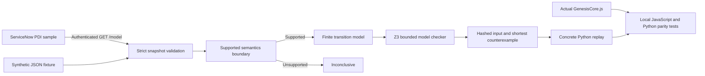

# Architecture and semantic contract

The model semantics below remain sequential. Workspace 0.2 adds a separate local transactional request store and an uninstalled ServiceNow stage-claim guard; see [WORKSPACE_0_2.md](WORKSPACE_0_2.md) and [CONCURRENCY_UPGRADE.md](CONCURRENCY_UPGRADE.md). Model verification does not prove either storage layer's concurrent behavior.

## Achievable first slice

The PDI implements a custom, sequential privileged-access request, not actual access provisioning. `GenesisCore` enforces the contract. `GenesisGateway` supplies authenticated identity and persists records. A JSON system property is the declarative workflow configuration used by both execution and export. GENESIS lowers only this known configuration into a transition model. This is explicit semantic extraction, not code inference.

The local service needs no account, paid plugins, LLM, database, or external simulation engine. A live installation needs a PDI, administrative setup access, three synthetic test users, and an authenticated export account. NetworkX and a visualization front end would add little to this three-edge graph and are deferred.

## State and transitions

An initial state is `(draft, requester, assigned_approver, approved_by=null)`. Requester and assigned approver are symbolic choices from a finite configured population. Creation is initialization and is not counted as a transition. Users are sorted by ID to canonicalize witnesses.

| Action | Source → destination | Guard | Effect |
|---|---|---|---|
| Submit | draft → pending | actor equals requester | approved_by unchanged |
| Approve | pending → approved | actor equals assigned approver and has configured approver eligibility | approved_by becomes actor |
| Fulfill | approved → fulfilled | actor has configured fulfiller eligibility | approved_by unchanged |

The corrected approval transition additionally requires `actor != requester`. Immutable requester/assignment values are framed across all transitions. There is no terminal stuttering, rejection, reassignment, cancellation, delegation, parallelism, or retry transition. Invalid actions are rejected and do not advance model time. The property is a safety property; liveness and deadlock freedom are not checked. For example, assigning Alice to her own request under the corrected policy can leave it pending. Choose Bob for the happy path.

Invariant:

`state ∈ {approved, fulfilled} ⇒ approved_by != requester`

The requester is the submitting user in this sample. It is not a distinct requested-for beneficiary. Proxy submissions and multiple accounts controlled by one human are outside the model. Eligibility labels are explicitly configured domain labels, not an analysis of platform role inheritance or ACL behavior. The PDI gateway additionally requires all configured users to be active and to have `u_genesis_demo`; it rejects an export otherwise.

## Verification

For each exact length `d` from zero through the requested bound, Z3 solves:

`Initial(s0) ∧ T(s0,a0,s1) ∧ ... ∧ T(s[d−1],a[d−1],sd) ∧ Bad(sd)`

The first satisfiable depth is shortest. Extra satisfiability checks select the lexicographically least requester, assignment, and action-actor vector. A separate concrete interpreter replays every emitted witness. The input hash uses SHA-256 of JSON sorted by object key with compact separators and ASCII escaping; array order remains significant.

Every operation has a total solver time budget. Unknown or timeout yields `inconclusive`. Input is limited to eight actors, six transitions, and ten seconds per request; defaults are three transitions and two seconds. Each verification uses a separate Z3 context for API concurrency. This finite acyclic model has at most three successful transitions, but the API deliberately reports bounded results rather than a general safety certificate.

Malformed contract fields fail validation. Unsupported schema versions, semantics, step sequences, or declared unsupported features produce `inconclusive`. Unknown extra JSON fields fail validation instead of being ignored. The system cannot detect a feature omitted from the contract: verifying completeness of a live export remains a human responsibility.

## Fidelity and trust boundary

The model checks possible new requests under one fixed snapshot. It does not reconstruct historical approval records or synchronize runtime state continuously. The snapshot hash identifies the submitted bytes after canonicalization; it is neither an authentic ServiceNow signature nor proof of exporter completeness.

The PDI stores the snapshot on each request and rejects subsequent actions after any configuration change. This prevents a request from silently switching modeled policy versions. Administrators can still bypass or modify the sample. Before claiming a live finding, review the deployed scripts, ACLs, table rules, and configuration against this repository, and run the acceptance sequence. Any additional Business Rule, Flow, ACL-dependent execution, timer, script side effect, concurrency, external integration, or inherited behavior must be declared unsupported until modeled and validated.

## Deliberately deferred

Flow Designer/legacy workflow extraction; ACL and arbitrary JavaScript analysis; delegation and proxy identities; multiple workflows; event-log synchronization; asynchronous/concurrent semantics; real provisioning; SLA prediction; automatic remediation; signed evidence; production release enforcement; LLM explanations. No unsupported component is hidden behind an AI-generated safety judgment.
